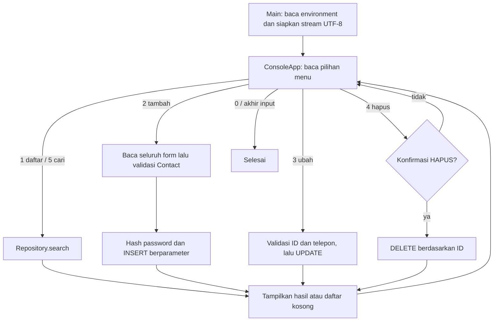

# Alur kode Java Console CRUD

Program ini mengelola data kontak contoh melalui satu menu terminal. Tidak ada proses login; `role` hanya kolom data. Hak operasi mengikuti akun MySQL yang digunakan program.

| Bagian | Sumber |
| --- | --- |
| Entry point dan stream UTF-8 | [Main.java](../src/main/java/id/javacrud/Main.java) |
| Menu, form, pesan dan akhir input | [ConsoleApp.java](../src/main/java/id/javacrud/ConsoleApp.java) |
| Bentuk kontak dan validasi field | [Contact.java](../src/main/java/id/javacrud/Contact.java), [Validation.java](../src/main/java/id/javacrud/Validation.java) |
| Query serta penutupan resource JDBC | [ContactRepository.java](../src/main/java/id/javacrud/ContactRepository.java) |
| Hash password contoh | [Passwords.java](../src/main/java/id/javacrud/Passwords.java) |
| Koneksi dari environment | [Database.java](../src/main/java/id/javacrud/Database.java) |
| Struktur tabel kosong | [001-schema.sql](../database/001-schema.sql) |

## Input sampai database

`Main.main()` meminta `DB_URL`, `DB_USER` dan `DB_PASSWORD`. Konfigurasi yang hilang atau bukan JDBC MySQL menghentikan startup dengan pesan konfigurasi. Membuka program tidak membuat schema atau memasukkan kontak. Schema disiapkan terpisah sesuai [README](../README.md).

`ConsoleApp.run()` memakai loop menu, bukan pemanggilan menu secara rekursif. Tambah kontak membaca seluruh form sebelum memanggil repository. Konstruktor `Contact` memeriksa nama, gender, telepon, email, alamat, role dan tanggal lahir. Password diperiksa dan di-hash saat `ContactRepository.add()` dipanggil. Database membuat ID; output sukses memakai ID yang dikembalikan JDBC.

`search()` memakai `LOCATE` dengan parameter pada nama/email yang diubah ke huruf kecil. Pencarian kosong menampilkan semua kontak; `%` dan `_` tidak menjadi wildcard. Query hanya mengambil kolom kontak, sehingga password/hash tidak masuk model atau keluaran daftar. `updatePhone()` mengubah telepon satu ID. `delete()` baru dijalankan setelah konfirmasi persis `HAPUS`. Jumlah baris terdampak menentukan pesan berhasil atau ID tidak ditemukan.

Setiap metode repository membuka dan menutup koneksi, statement serta result set melalui try-with-resources. Operasi tulis masing-masing terdiri dari satu statement dengan autocommit JDBC; tidak ada transaksi lintas beberapa tindakan menu atau pengulangan otomatis operasi tulis. Data tetap tersimpan di MySQL setelah program ditutup. Volume Compose dipertahankan oleh `docker compose down` tanpa opsi penghapusan volume.

## Kesalahan dan akhir input

Pilihan menu yang tidak dikenal kembali ke menu. Validasi gagal menampilkan alasan tanpa menyatakan data berhasil disimpan. SQLException menampilkan SQLState, tanpa menyalin URL/password atau pesan exception database ke pengguna. Bila balasan operasi tulis tidak pasti, baca ulang data sebelum mengulanginya; program ini tidak menyediakan kunci idempotensi.

Akhir input pada menu mengakhiri program. Akhir input di tengah form menghentikan form sebelum repository dipanggil. Password contoh dibaca sebagai teks terminal biasa; hashing tidak menyembunyikan karakter yang diketik. Gunakan data latihan sesuai README.

[ConsoleAppTest](../src/test/java/id/javacrud/ConsoleAppTest.java) mencakup alur menu, pembatalan hapus, akhir input dan pesan kegagalan. [RepositoryTest](../src/test/java/id/javacrud/RepositoryTest.java) memeriksa CRUD, pencarian literal, ID tidak ditemukan dan email duplikat pada H2 terisolasi. Tes H2 tidak menggantikan pemeriksaan driver/schema pada MySQL.
